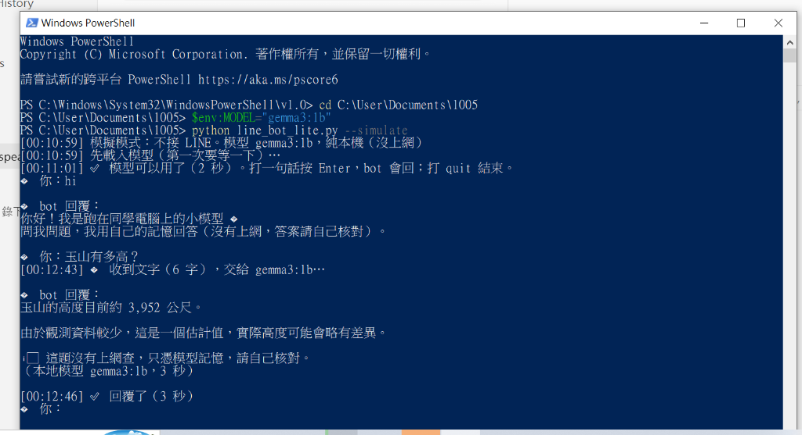

# LINE bot 輕量版：本地小模型問答機器人（回家作業）

> **作業項目**：WEEK 6 回家作業 — 在自己的電腦上運行開源小模型回答問題（無顯示卡、純 CPU 亦可順暢運行）。  
> **專案倉庫**：[https://github.com/411513004-coder/1021](https://github.com/411513004-coder/1021)  
> **作業關卡**：完成 **關卡 A（模擬模式）**  

---

## 📸 對話成果截圖（關卡 A 模擬模式）

以下為在 Windows PowerShell 終端機中，使用本機小模型 `gemma3:1b` 進行模擬問答之實測截圖：



* 測試問題 1：`hi` → 回覆小模型使用說明與免責提示。
* 測試問題 2：`玉山有多高？` → 回覆約 3,952 公尺，模型耗時約 3 秒完成推理。

---

## 💻 執行設備與實測數據

* **作業模型**：`gemma3:1b`（參數量約 1B，下載大小約 806 MB）
* **電腦設備**：Intel Core i5-10210U（筆電 4 核心 / 8 執行緒 CPU）、12 GB RAM
* **顯示卡**：**無獨立顯示卡**（使用 CPU 推理）
* **推理耗時**：**一題約 2 ~ 3 秒**（模型載入常駐記憶體後極為流暢）
* **卡住與解決**：
  1. 初次啟動時，Windows 終端機預設編碼（cp950）遇到日誌中的 Emoji 表情符號時引發編碼報錯；已在 `line_bot_lite.py` 啟動區塊加入 `sys.stdout.reconfigure(encoding="utf-8")`，成功修復。

---

## 🛠️ 怎麼裝（Installation）

1. **安裝 Python 3**（3.10 以上版本，只使用 Python 內建標準函式庫，**無需 `pip install`**）：
   ```powershell
   python --version
   ```
2. **安裝 Ollama**：
   * 前往 [Ollama 官網](https://ollama.com/download) 下載 Windows 安裝檔並安裝，啟動後工作列會出現小羊駝圖示。
3. **下載輕量模型**：
   ```powershell
   ollama pull gemma3:1b
   ```

---

## 🚀 怎麼跑（Usage）

### 關卡 A：模擬模式（不接 LINE、不開通道）
在終端機開啟模擬模式進行本地對話：

```powershell
# 設定使用 gemma3:1b 模型
$env:MODEL="gemma3:1b"

# 啟動模擬模式
python line_bot_lite.py --simulate
```
* 出現 `📱 你：` 即可打字提問。
* 輸入 `quit` 即可離開模擬模式。

### 關卡 B：真的接 LINE（選做）
如需連接真實 LINE 帳號：
```powershell
$env:MODEL="gemma3:1b"
python line_bot_lite.py
```
依提示貼上 LINE Channel Access Token 與 Channel Secret，程式會自動開啟 Cloudflare Tunnel 並配置 Webhook。

---

## 📝 程式修改說明（Changelog）

相較於老師官方原始版本的 `line_bot_lite.py`，本版本做了以下相容性增強：
1. **Windows 控制台 UTF-8 相容性修復**：
   在程式開頭導入區塊加入編碼重定向：
   ```python
   if sys.platform == "win32":
       try:
           sys.stdout.reconfigure(encoding="utf-8")
           sys.stderr.reconfigure(encoding="utf-8")
       except Exception:
           pass
   ```
   解決了 Windows 繁體中文環境下 `cp950` 無法印出 `✅`、`🤖` 等字符而 crash 的問題。